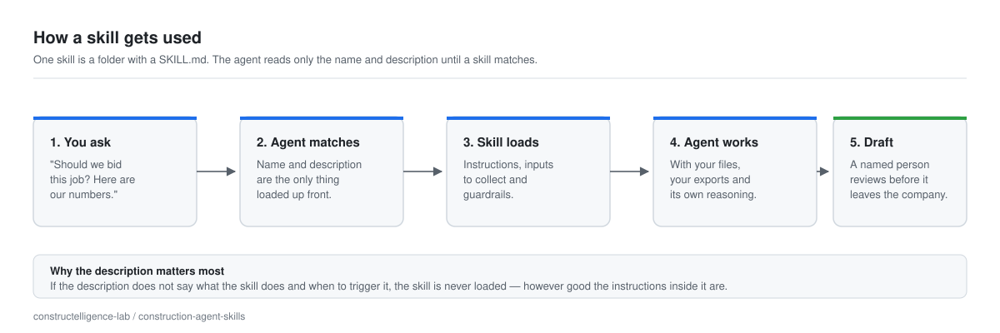
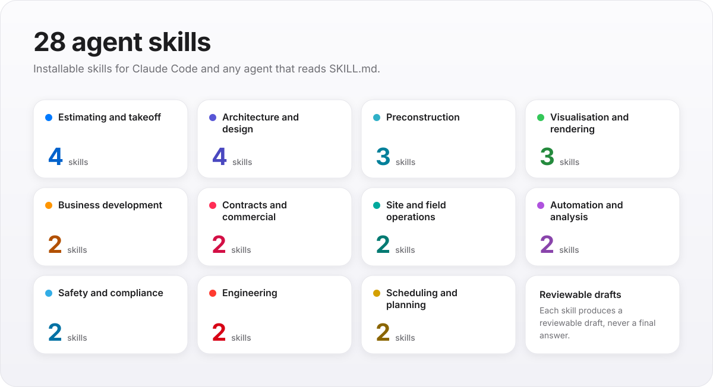
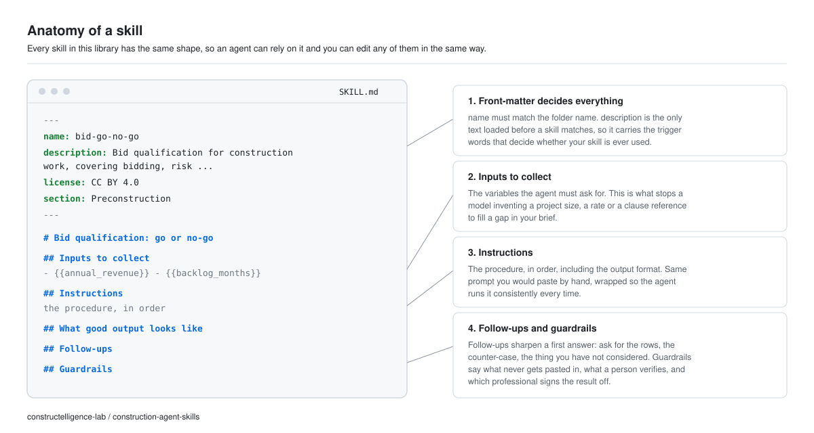
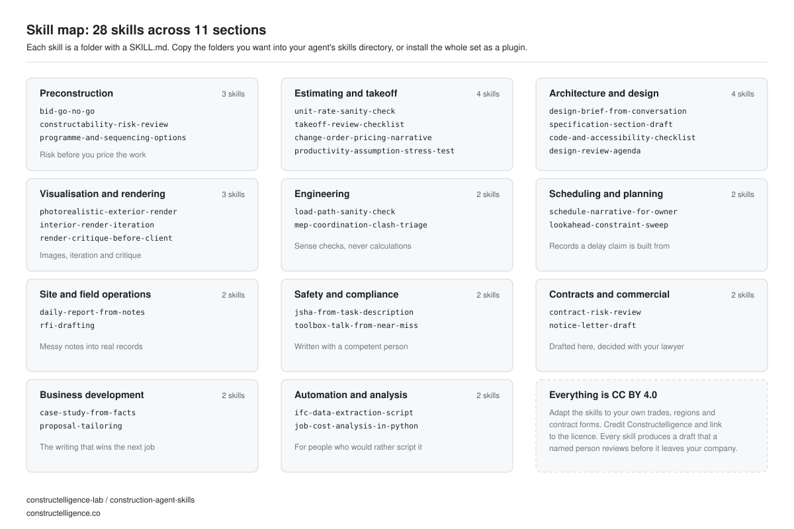

<h1 align="center">Construction agent skills</h1>

<p align="center"><strong>28 installable skills for Claude Code, Claude apps and any agent that reads a SKILL.md</strong></p>

<p align="center">Estimating · architecture · visualisation · engineering · scheduling · site operations · safety · commercial · business development</p>

<!-- begin:badge -->
   
<!-- end:badge -->

<p align="center"></p>

<p align="center">
  <picture>
    <source media="(prefers-color-scheme: dark)" srcset="assets/skills-dark.svg">
    
  </picture>
</p>

## Install

**Claude Code — as a plugin** (recommended: updates come with a pull):

```text
/plugin marketplace add constructelligence-lab/construction-agent-skills
/plugin install construction@construction-skills
```

**Claude Code — as plain skills**, if you would rather keep them in your own folder:

```bash
git clone https://github.com/constructelligence-lab/construction-agent-skills.git
mkdir -p ~/.claude/skills
cp -r construction-agent-skills/skills/* ~/.claude/skills/
```

Copy only the skills you want — each folder is independent, and nothing here needs a build step or a
dependency. For a project-scoped install, copy the same folders into `.claude/skills/` inside the
repository you are working in.

**Claude apps and other agents.** Zip the `skills/` folder and upload it wherever your tool accepts
skills, or point your agent at the `SKILL.md` files directly — the format is plain Markdown with
front-matter, so nothing here is tied to one vendor.

## What is in it

<!-- begin:index -->
### Preconstruction

*Qualifying work, framing the programme, finding risk before you price it.*

| Skill | Use it when | Tags |
| --- | --- | --- |
| [**Bid qualification: go or no-go**](skills/bid-go-no-go/SKILL.md)<br>`bid-go-no-go` | An invitation to bid lands and you need a defensible recommendation before you spend a week estimating it. | `bidding` `risk` `preconstruction` |
| [**Constructability risk review of a drawing set**](skills/constructability-risk-review/SKILL.md)<br>`constructability-risk-review` | You are pricing or planning a job and want a structured list of buildability questions before the bid goes in. | `preconstruction` `drawings` `risk` |
| [**Programme and sequencing options**](skills/programme-and-sequencing-options/SKILL.md)<br>`programme-and-sequencing-options` | You have a target completion date and a rough scope, and you want the plausible sequencing options on the table before you build a CPM schedule. | `preconstruction` `programme` `sequencing` |

### Estimating and takeoff

*Sanity checks, pricing narratives and takeoff review.*

| Skill | Use it when | Tags |
| --- | --- | --- |
| [**Unit rate sanity check**](skills/unit-rate-sanity-check/SKILL.md)<br>`unit-rate-sanity-check` | An estimate is nearly finished and you want a second pair of eyes on whether the rates and quantities hang together — before the bid goes in, not after. | `estimating` `pricing` `review` |
| [**Takeoff review checklist**](skills/takeoff-review-checklist/SKILL.md)<br>`takeoff-review-checklist` | A takeoff has been produced — by a person, by software, or by one of the tools in our [open source construction tools](https://github.com/constructelligence-lab/open-source-construction-tools) list — and it needs a review that is actually systematic. | `takeoff` `quantities` `quality` |
| [**Change order pricing narrative**](skills/change-order-pricing-narrative/SKILL.md)<br>`change-order-pricing-narrative` | The numbers are agreed internally and now need to be presented so they are hard to argue with — typically for a priced change that a client or a subcontractor will scrutinise. | `change-orders` `commercial` `pricing` |
| [**Productivity assumption stress test**](skills/productivity-assumption-stress-test/SKILL.md)<br>`productivity-assumption-stress-test` | An estimate depends on production rates you have assumed rather than measured, and you want to know how much of the margin is riding on them. | `productivity` `labour` `risk` |

### Architecture and design

*Briefs, specifications, code topics and design review.*

| Skill | Use it when | Tags |
| --- | --- | --- |
| [**Design brief from a client conversation**](skills/design-brief-from-conversation/SKILL.md)<br>`design-brief-from-conversation` | You have come out of a client meeting with scattered notes and need a written brief that the client can confirm or correct before design work starts. | `brief` `client` `architecture` |
| [**Specification section draft**](skills/specification-section-draft/SKILL.md)<br>`specification-section-draft` | You need a first draft of a specification section structure so you are editing rather than staring at an empty document — with the understanding that the technical content is yours, not the model's. | `specification` `documentation` `quality` |
| [**Code and accessibility checklist for a design review**](skills/code-and-accessibility-checklist/SKILL.md)<br>`code-and-accessibility-checklist` | You want a structured set of compliance questions to work through for a design, recognising that the model does not know your local code and must not be treated as knowing it. | `code` `accessibility` `compliance` |
| [**Design review agenda that finds problems**](skills/design-review-agenda/SKILL.md)<br>`design-review-agenda` | You are running a design or coordination review and want an agenda that surfaces conflicts rather than walking through the drawings in order. | `coordination` `meetings` `design` |

### Visualisation and rendering

*Image prompts, iteration and critique before a client sees it.*

| Skill | Use it when | Tags |
| --- | --- | --- |
| [**Photorealistic exterior render prompt**](skills/photorealistic-exterior-render/SKILL.md)<br>`photorealistic-exterior-render` | You need a client-ready exterior visual quickly, before the model is advanced enough for a proper render, or to explore a façade direction. | `rendering` `visualisation` `marketing` |
| [**Interior render: iteration prompt**](skills/interior-render-iteration/SKILL.md)<br>`interior-render-iteration` | The first interior image is close but wrong — the light, the proportions or the materials — and you want to change one thing at a time rather than regenerate from scratch. | `rendering` `interior` `iteration` |
| [**Render critique before it goes to the client**](skills/render-critique-before-client/SKILL.md)<br>`render-critique-before-client` | You are about to send a visual to a client and want a hard critique first — one that finds the things an architect, a planner or a contractor would spot immediately. | `rendering` `review` `presentation` |

### Engineering

*Structural and MEP sense checks, with an engineer and never instead of one.*

| Skill | Use it when | Tags |
| --- | --- | --- |
| [**Structural load path sanity check**](skills/load-path-sanity-check/SKILL.md)<br>`load-path-sanity-check` | You are preparing for a coordination or value-engineering discussion and want the obvious load path and stability questions on the table. | `structure` `review` `engineering` |
| [**MEP coordination and clash triage**](skills/mep-coordination-clash-triage/SKILL.md)<br>`mep-coordination-clash-triage` | You have a clash report or a coordination problem list and need to decide which clashes matter, in what order to resolve them, and who should move. | `mep` `coordination` `bim` |

### Scheduling and planning

*Narratives, look-aheads and the records a delay claim is built from.*

| Skill | Use it when | Tags |
| --- | --- | --- |
| [**Schedule narrative for the owner**](skills/schedule-narrative-for-owner/SKILL.md)<br>`schedule-narrative-for-owner` | The monthly schedule update is done and needs the narrative section: what moved, why, what you are doing about it, and what you need — without excuses and without jargon. | `schedule` `reporting` `communication` |
| [**Three-week lookahead constraint sweep**](skills/lookahead-constraint-sweep/SKILL.md)<br>`lookahead-constraint-sweep` | You are building the next three-week lookahead and want to remove constraints before they stop work, rather than reporting them after the fact. | `lookahead` `field` `planning` |

### Site and field operations

*Turning field notes into records somebody can act on.*

| Skill | Use it when | Tags |
| --- | --- | --- |
| [**Daily report from messy field notes**](skills/daily-report-from-notes/SKILL.md)<br>`daily-report-from-notes` | The day's notes are a mix of texts, voice-note reminders and scribbles, and the report needs to be written before you go home — with the facts intact and nothing invented. | `field` `records` `daily-report` |
| [**RFI drafting that gets answered**](skills/rfi-drafting/SKILL.md)<br>`rfi-drafting` | Something on site does not match the drawings and you need an RFI that is clear enough to be answered first time, with the schedule impact stated. | `rfi` `documents` `coordination` |

### Safety and compliance

*Task-specific safety documents, written with a competent person.*

| Skill | Use it when | Tags |
| --- | --- | --- |
| [**Job safety analysis from a task description**](skills/jsha-from-task-description/SKILL.md)<br>`jsha-from-task-description` | You are preparing a task-specific safety analysis and want a structured first draft to edit with the crew, rather than starting from a template that says nothing about this job. | `safety` `jsha` `field` |
| [**Toolbox talk from a real near miss**](skills/toolbox-talk-from-near-miss/SKILL.md)<br>`toolbox-talk-from-near-miss` | Something nearly went wrong on this site and you want a five-minute talk that lands with the crew, rather than a generic briefing they have heard ten times. | `safety` `training` `briefing` |

### Contracts and commercial

*Notices, risk reviews and payment narratives, drafted for review.*

| Skill | Use it when | Tags |
| --- | --- | --- |
| [**Contract risk review preparation**](skills/contract-risk-review/SKILL.md)<br>`contract-risk-review` | A contract or subcontract is on your desk and you want the risk topics organised before it goes to your lawyer, so the expensive hours are spent on judgement rather than on reading out loud. | `contracts` `risk` `commercial` |
| [**Notice letter draft**](skills/notice-letter-draft/SKILL.md)<br>`notice-letter-draft` | An event has occurred and the contract requires written notice. | `notices` `claims` `correspondence` |

### Business development

*Case studies, proposals and the writing that wins the next job.*

| Skill | Use it when | Tags |
| --- | --- | --- |
| [**Project case study from the facts**](skills/case-study-from-facts/SKILL.md)<br>`case-study-from-facts` | You have finished a job worth writing about and need a case study for the website, a proposal or a prequalification pack — without inventing anything and without breaching confidentiality. | `marketing` `case-study` `bd` |
| [**Tailoring a proposal to the client's actual concerns**](skills/proposal-tailoring/SKILL.md)<br>`proposal-tailoring` | You have a standard proposal structure and a specific client, and you want the document to answer what *they* are worried about instead of repeating your company history. | `proposals` `bidding` `bd` |

### Automation and analysis

*For the person who would rather script it than retype it.*

| Skill | Use it when | Tags |
| --- | --- | --- |
| [**IFC data extraction script**](skills/ifc-data-extraction-script/SKILL.md)<br>`ifc-data-extraction-script` | You need a repeatable way to pull data out of IFC models — quantities, spaces, properties — instead of clicking through them, and you would rather review code than write the boilerplate. | `ifc` `bim` `python` `automation` |
| [**Job cost analysis in Python or pandas**](skills/job-cost-analysis-in-python/SKILL.md)<br>`job-cost-analysis-in-python` | Your accounting system will give you a job cost export but not the analysis you want, and the work is repetitive enough to script rather than rebuild in a spreadsheet every month. | `job-cost` `python` `analysis` `automation` |

<!-- end:index -->

## Anatomy of a skill

<p align="center"></p>

Every skill has the same five parts, so you can edit any of them without relearning the shape:

| Part | Why it is there |
| --- | --- |
| `name` and `description` in the front-matter | The `description` is the only text loaded before a skill matches, so it carries the trigger words. If it is vague, the skill is never used |
| **Inputs to collect** | The variables the agent must ask for, which is what stops it inventing a project size, a rate or a clause reference |
| **Instructions** | The procedure and the output format, in order |
| **What good output looks like** | How to tell a useful answer from a fluent one |
| **Follow-ups** and **Guardrails** | How to sharpen the answer, what never gets pasted in, and which professional signs it off |

## Coverage

<p align="center"></p>

## How this library was built

The skills were generated from the
[construction prompts library](https://github.com/constructelligence-lab/construction-prompts) and then
given skill front-matter, input lists and guardrails. That keeps one source of truth for the instructions
and makes it cheap to keep both libraries in step:

```bash
python3 scripts/import_prompts.py --source ../construction-prompts/prompts   # regenerate skills
python3 scripts/build_index.py                                              # rebuild the index and badge
python3 scripts/validate.py                                                 # check them
```

CI runs the build and the validator on every push, and fails if the index in this README has drifted from
the files — so the tables above cannot quietly go stale.

## Ground rules

- **A person owns every output.** These skills produce drafts. Nothing goes to a client, an owner, a
  subcontractor or a regulator without a named reviewer.
- **Never paste** contracts under negotiation, pricing or bid strategy, personal or medical data,
  anything under an NDA, or anything a client has asked you to protect.
- **Verify anything factual** — quantities, dates, clause references, code sections and figures — against
  the source document.
- **Use a business tier** with terms that exclude your data from model training, and a written company rule
  on what may be pasted. Skills do not change what your AI tool does with your data; your tool's terms do.
- **Professional work stays professional.** Structural and MEP skills are sense checks, not calculations.
  Safety skills are written with a competent person. Commercial skills are drafted for your lawyer to
  review, not instead of it.

## Contributing

Add a folder under `skills/<name>/SKILL.md`, then run the build and the validator. A useful skill says
where it came from — a real job, a real failure mode — and what it is bad at. Skills that only sound
impressive do not belong here.

## Licence

**CC BY 4.0.** Adapt them for your trades, regions, contract forms and house style, and use them
commercially. Credit Constructelligence and link to the licence.

<!-- begin:family -->
## More from Constructelligence

Open construction resources from the same team, all maintained alongside this one:

| Repository | What it is |
| --- | --- |
| [AI in construction](https://github.com/constructelligence-lab/ai-in-construction) | A practical guide to AI in construction: what works today, what the data has to look like, the risks, and a 90-day plan. |
| [Construction data migration](https://github.com/constructelligence-lab/construction-data-migration) | A guide and toolkit for moving a contractor between systems, and proving nothing was lost. |
| [Construction project records](https://github.com/constructelligence-lab/construction-project-records) | Open schemas, templates and a checker for RFIs, submittals, change events, daily reports and punch lists. |
| [Construction reference data](https://github.com/constructelligence-lab/construction-data) | Cost codes, units, waste factors, pay units, trade sequence, glossary and metric formulas in CSV. |
| [Construction reference MCP server](https://github.com/constructelligence-lab/construction-mcp) | An offline MCP server that gives AI assistants construction reference data and calculators. |
| [Construction prompts](https://github.com/constructelligence-lab/construction-prompts) | 28 prompts for ChatGPT, Claude and Gemini, from bid go/no-go to notice letters. |
| [Open source construction tools](https://github.com/constructelligence-lab/open-source-construction-tools) | Open source software for BIM, CAD, scheduling and site work, verified against the GitHub API. |
| [Revit MCP server](https://github.com/constructelligence-lab/revit-mcp) | Connect Autodesk Revit to Claude, Cursor and any MCP client: read the model, render photoreal pictures with Blender, export PDF/IFC/glTF. Read-only until you allow writes. |

<!-- end:family -->

---

*Maintained by [Constructelligence](https://constructelligence.co) — building the AI infrastructure for
construction.*
